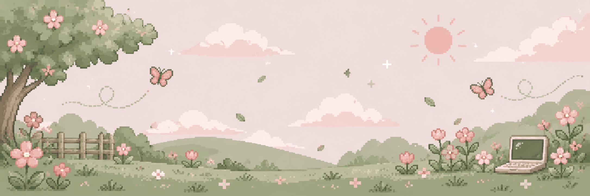

# 🦋 Hello, World! I'm Chell! ♡

### `A curious mind in a world full of possibilities.`

---

## 💻 ABOUT ME

Hello! I'm a first-year **BS Information Technology student at National University**.

I'm a curious mind with a creative side, always looking for something new to learn, explore, and create. I'm still at the beginning of my coding journey, but I'm excited to see where it takes me!

- 🌱 Currently learning: Java and programming fundamentals
- 💡 Interested in: App development, web development, UI/UX, and game development
- 🎨 Creative side: Art, photography, and little creative projects
- 🌊 Outside the screen: Traveling, beach trips, music, and discovering new food
- 🦋 Fun fact: I love collecting experiences as much as I love collecting new ideas!

> "There's always something new to learn, somewhere new to go, and something new to create."

---

## 🌱 CURRENTLY EXPLORING

---

## 🖥️ TECH STACK

**Currently Learning**

**Tools I Use**

---

## 🎯 MY LITTLE GOALS

- [ ] Strengthen my programming fundamentals
- [ ] Explore different programming languages
- [ ] Build my first personal project
- [ ] Learn web and app development
- [ ] Improve my problem-solving skills
- [ ] Create something I'm genuinely proud of

---

## 📂 MY PROJECT CORNER

A little collection of my learning progress, experiments, and projects.

📁 School Activities

- Midterm Laboratory Activities
- Final Laboratory Activities
- Programming Exercises

🔐 Personal Projects

- Coming soon...
- More ideas are loading!

---

## 💌 LET'S CONNECT!

 

 

 

Always open to learning, sharing ideas, collaborating, or simply meeting fellow learners!

---

### ♡ Thank you for stopping by!

`Currently under development — just like my code.`

🦋 ✦ 🌷 ✦ 💻 ✦ 🌷 ✦ 🦋

